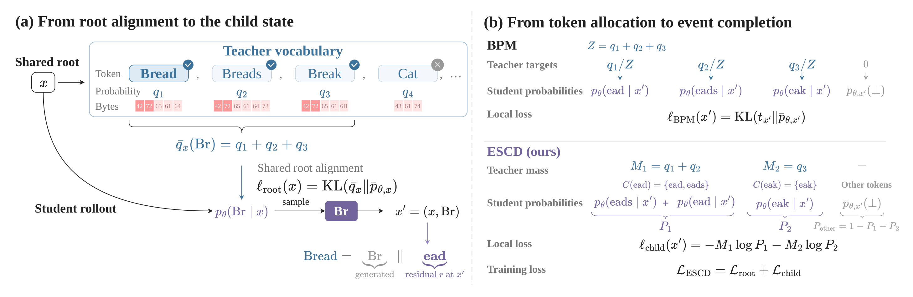
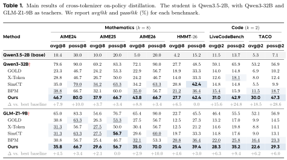

# Beyond Token Alignment: Event Completion for Cross-Tokenizer On-Policy Distillation

**Jiacheng Liu\*‡, Jingwei Song\*, Qituan Zhang, Siheng Chen, Linfeng Zhang†**  
Shanghai Jiao Tong University · EPIC Lab · The University of Hong Kong · Fudan University  
\* Equal contribution · † Corresponding author · ‡ Project leader

[](https://arxiv.org/abs/2609.34738)
[](ESCD.pdf)
[](https://huggingface.co/datasets/mytcl/SciDeriv)
[](https://huggingface.co/datasets/mytcl/PHYRD-40)

The [arXiv paper](https://arxiv.org/abs/2609.34738) is an earlier version.
Please refer to the [latest PDF](ESCD.pdf) for the updated technical report.

**ESCD supervises completion of teacher events, without prescribing a probability
split among valid student-token completions.** This release contains the training
implementation and portable recipes for Table 1: **ESCD, BPM, SimCT, GOLD and
X-Token**. It excludes agentic training and the internal cluster/evaluation platform.

## Method

<p align="center"></p>

Different tokenizers can express a teacher token with multiple student tokens.
After the student enters such an event, several next tokens may complete its
remaining bytes. ESCD supervises their **total probability**, together with root
alignment. It uses normally visited student states, without additional rollouts
or vocabulary changes.

The public `escd_full_vocab` plugin uses the complete teacher vocabulary, root
forward KL and a unit-weight completion-set term. See [method notes](docs/methods.md)
for objective dispatch and the adaptations of comparison methods.

## Results

<p align="center"><a href="assets/table1.pdf"></a></p>

<p align="center"><a href="assets/table1.pdf">Vector PDF</a> · <a href="assets/table1.png">High-resolution PNG</a></p>

These are **paper-reported results**, not new results from release checks.
The student is Qwen3.5-2B, with Qwen3-32B and GLM-Z1-9B-0414 teachers.
Mathematics uses avg@8/pass@8; code uses avg@2/pass@2. See
[reproduction scope](docs/reproduction.md) for configuration provenance and limits.

## Data

| Dataset | Role | Size | Source |
| --- | --- | ---: | --- |
| DAPO-Math + TACO | Table 1 training | 20,000 | [Original BPM release](https://huggingface.co/datasets/K1zE/BPM) |
| SciDeriv | Large-scale training in the report | 17,577 | [Hugging Face](https://huggingface.co/datasets/mytcl/SciDeriv) |
| PHYRD-40 | Physics evaluation | 40 | [Hugging Face](https://huggingface.co/datasets/mytcl/PHYRD-40) |

We reference the original BPM mixture instead of renaming it. SciDeriv and PHYRD-40
include JSONL, Parquet, data cards and the report. PHYRD-40 solutions and rubrics
are for grading only. Large-scale SFT/MoE recipes and the private evaluation
platform are outside this Table 1 training release.

```bash
hf download K1zE/BPM --repo-type dataset mix-20k.jsonl --local-dir data/bpm
```

## Installation

Use Linux and Python 3.11 with a compatible CUDA/PyTorch, Megatron-LM,
Megatron Bridge/mbridge, SGLang and Ray stack. The commands below install into an
**existing GPU training environment**; they do not install or validate that entire
stack. Keep the included adapted Slime backend.

```bash
git clone https://github.com/Tammytcl/ESCD.git
cd ESCD
pip install -r requirements-training.txt
pip install -e ./slime --no-deps
pip install -e . --no-deps
export MEGATRON_ROOT=/opt/Megatron-LM  # your installation
export PYTHONPATH="$PWD:$PWD/slime:$MEGATRON_ROOT:${PYTHONPATH:-}"
```

Install on teacher and student nodes. The project registers the required
`opd_bpm_binary_hidden` SGLang plugin. Weights are downloaded separately:
[student](https://huggingface.co/Qwen/Qwen3.5-2B),
[Qwen teacher](https://huggingface.co/Qwen/Qwen3-32B),
[GLM teacher](https://huggingface.co/zai-org/GLM-Z1-9B-0414).

## Configure and preview

```bash
mkdir -p configs/local
cp configs/examples/escd.yaml configs/local/run.yaml
# Set local model, data and output paths, visible on all participating nodes.
python scripts/training/compile_config.py --config configs/local/run.yaml --format json
OPD_CONFIG="$PWD/configs/local/run.yaml" DRY_RUN=1 bash scripts/training/train.sh
```

Choose a complete template rather than changing only the algorithm name:

| Method | Qwen3-32B teacher | GLM-Z1-9B-0414 teacher |
| --- | --- | --- |
| ESCD | [escd.yaml](configs/examples/escd.yaml) | [escd_glm.yaml](configs/examples/escd_glm.yaml) |
| BPM | [bpm.yaml](configs/examples/bpm.yaml) | [bpm_glm.yaml](configs/examples/bpm_glm.yaml) |
| SimCT | [simct.yaml](configs/examples/simct.yaml) | [simct_glm.yaml](configs/examples/simct_glm.yaml) |
| GOLD | [gold.yaml](configs/examples/gold.yaml) | [gold_glm.yaml](configs/examples/gold_glm.yaml) |
| X-Token (H-KL adaptation) | [xtoken.yaml](configs/examples/xtoken.yaml) | [xtoken_glm.yaml](configs/examples/xtoken_glm.yaml) |

The recipe uses **64 GPUs**: 16 teacher, 32 actor and 16 rollout. This is not a
single-GPU example. Batch size is 16, prompt limit 5,120, response limit 27,648,
sequence limit 33,280. The inherited `num_rollout: 2500` template is not evidence
of the exact selected iteration behind every historical Table 1 checkpoint.

## Launch on your cluster

Allocate machines using your own scheduler. Model, code, data and hidden-state
paths must be shared; Ray/teacher ports must be reachable. Use the same fresh run
ID and directory on every machine:

```bash
export PROJECT_ROOT=/shared/ESCD
export OPD_CONFIG="$PROJECT_ROOT/configs/local/run.yaml"
export OPD_RUN_ID=escd-example-001  # choose a fresh ID
export OPD_TEACHER_COORD_DIR="/shared/escd-runs/$OPD_RUN_ID"
export OPD_BPM_BINARY_HIDDEN_DIR="$OPD_TEACHER_COORD_DIR/hidden"
cd "$PROJECT_ROOT"
```

On each of two 8-GPU teacher machines:

```bash
export NODE_RANK=0  # 1 on the second teacher node
export OPD_TEACHER_MODEL_PATH=/models/Qwen3-32B
export OPD_TEACHER_TP_SIZE=8
export OPD_TEACHER_CONTEXT_LENGTH=65536
bash scripts/training/teacher.sh
```

For GLM, use the GLM-Z1-9B-0414 path from the YAML. Teacher context capacity is
larger because the same response can be longer under the teacher tokenizer.

On each of six 8-GPU student/rollout machines:

```bash
export NODE_RANK=0  # distinct node ranks 0..5
export NNODES=6
export NPROC_PER_NODE=8
export MASTER_ADDR=192.0.2.10  # replace with student node 0's reachable IP
export OPD_TEACHER_COUNT=2
export SEED=1234
bash scripts/training/student.sh
```

The launcher waits for live teachers, starts/joins Ray, and assigns actor/rollout
GPUs from the YAML. Rank 0 propagates the job exit code and signals teachers to
stop. Use dedicated nodes: the launcher starts and stops local Ray processes.
No DLC credentials, resource-pool IDs or internal evaluation service are needed.

Checkpoints go to `run.save_dir`. For export, inspect
`python slime/tools/convert_torch_dist_to_hf.py --help` in the training environment.
Megatron loaders need the root containing `latest_checkpointed_iteration.txt`,
not a direct `iter_*` path.

## Layout and checks

```text
opd/cross_tokenizer/   ESCD and Table 1 objectives
slime/                adapted distributed backend and model adapters
configs/examples/     five methods × two teachers
scripts/training/     YAML compiler and teacher/Ray/student launchers
tests/                CPU numerical contracts
docs/                 method adaptations and reproduction scope
assets/               figures from the report
ESCD.pdf              latest technical report
```

```bash
python -m unittest discover -s tests -v
```

Numerical checks and command dry-runs do not establish GPU compatibility,
distributed correctness or benchmark reproduction.

## Acknowledgments and citation

Built on [Slime](https://github.com/THUDM/slime), Megatron-LM and SGLang.
See [third-party notices](THIRD_PARTY_NOTICES.md) and [baseline notes](docs/methods.md).

```bibtex
@misc{liu2026escd,
  title={Beyond Token Alignment: Event Completion for Cross-Tokenizer On-Policy Distillation},
  author={Jiacheng Liu and Jingwei Song and Qituan Zhang and Siheng Chen and Linfeng Zhang},
  year={2026},
  eprint={2609.34738},
  archivePrefix={arXiv},
  primaryClass={cs.CL},
  url={https://arxiv.org/abs/2609.34738}
}
```
